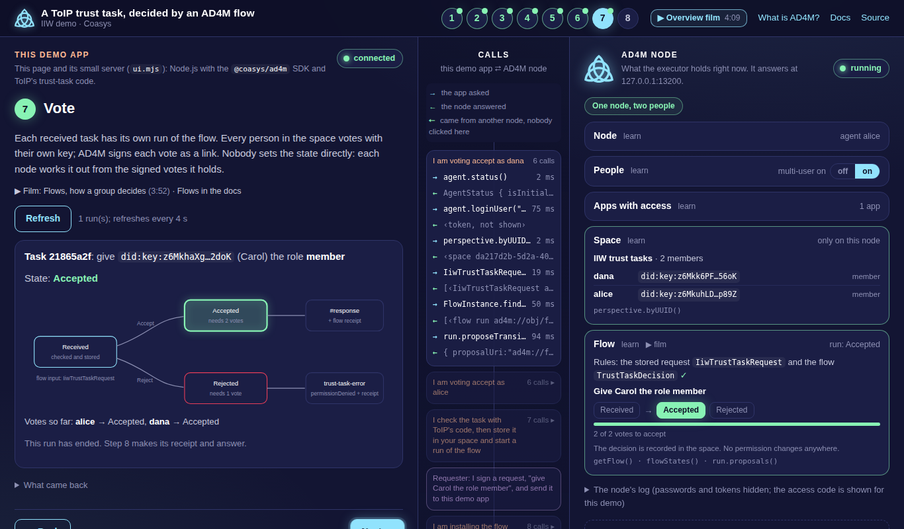

# A ToIP trust task, decided by an AD4M flow

A web page that walks you through one ToIP trust task decided by a vote in an AD4M space, from the
signed request to the signed answer.



## Start

```sh
git clone https://github.com/coasys/iiw-ad4m-trust-task-demo && cd iiw-ad4m-trust-task-demo
npm install
npm start
```

Then open <http://127.0.0.1:8740> and follow the steps on the page.

You need Linux (x64) or macOS (Apple silicon) and Node.js 22 or newer. The first run needs the network.

## More detail

A requester sends a signed ToIP trust task (`acl/grant/0.2`: "give Carol the role `member`") to an
AD4M space. The space holds a flow: its members vote, and when the flow ends the demo app asks AD4M
for a receipt of how they decided. The demo app answers the requester with a trust-task response
that carries the receipt and is signed with the app's own key, and the requester checks it.

You can run it two ways: a web page that guides you through each step (`npm start`), or one
command per step (`demo.mjs` for the AD4M side, `requester.mjs` for the other party). The page calls
the same functions as the commands. `guide.html` (open it from disk) explains the story with a
diagram of the flow. `NOTE.md` says what this shows and what it does not.

The page has two sides. On the left is this demo app, one step at a
time. On the right is your AD4M node, live: the node, the people on it, the apps with access, the
space and the flow. Between them, each button's `@coasys/ad4m` calls show up as they happen.

The flow needs two voters, so step 1 asks who you are:

- **I'm starting the demo.** You go through all eight steps below.
- **I'm joining someone, on this computer.** The demo already runs here. You add yourself as a
  second person on its node (multi-user mode), then vote (step 7) and check the receipt (step 8).
  The page remembers your choice in this browser, so two people on one computer use two browsers
  (or open `127.0.0.1:8740` in one and `localhost:8740` in the other).
- **I'm joining someone, with my own node.** You do steps 1 to 4 on your computer, then join the
  space with the `neighbourhood://` address the other person sends you (step 5), vote and check
  the receipt. The trust task arrives at their node, so you skip step 6.

Joining someone else's node over the network is not part of this demo: the executor listens on
127.0.0.1 unless started with `--localhost false`, and then passwords and tokens would cross the
network unencrypted.

The eight steps:

1. **Get the executor.** The page looks up the AD4M release for your computer and can download it
   into `bin/`. Or you give it the path of an executor you already have.
2. **Start the node.** Start, stop and status. The node keeps its data in `.node/`; its log is at
   the bottom of the node panel.
3. **Agent and people.** Create the node's agent or unlock it with its passphrase. Add a second
   person (each gets a login and a DID) and log them in. Adding a person turns multi-user mode on;
   the People card in the node panel switches it and shows the mode the node reports.
4. **Connect the page.** The page asks the node for a capability. The node writes a one-time
   6-digit code to its log; the page shows you that line, and you type the code in.
5. **Make a space.** A local space, a shared one (a neighbourhood, over a link server or Holochain),
   or join someone else's by its URL.
6. **The trust task and the flow.** Install the flow in the space, let the requester sign a trust
   task. The space's app checks it with ToIP's code and writes it into the space, and AD4M
   starts a run of the flow.
7. **Vote.** Each person votes with their own key; the diagram shows the state.
8. **The receipt and the answer.** AD4M's flow receipt and the signed answer on one side, the
   requester's checks on the other.

Each button shows the `@coasys/ad4m` calls it made and what came back. The page's server listens
on 127.0.0.1 only. It never sends passwords, passphrases, tokens or the node's admin credential to
the page, and it hides them in the log it shows. Ctrl-C stops the page and the node it started.

Some details:

- **Before the release is out**, step 1 downloads the staging build `v0.13.1-staging.6` instead.
  If neither is public, it says so: build the executor from source, or use one you were given,
  and give its path.
- **The code in step 4.** The page starts the node with `AD4M_LOG_SECRETS=1`. With that setting
  the executor prints the code of each capability request to its log. A node started from the
  command line without it prints no code, so start the node from the page.
- **Multi-user mode.** A space owned by a user on the node belongs to that user. The page's token
  for the node's agent does not reach it, so for that space the node's agent votes through the
  admin credential, as the command line does.
- **One person can only say no.** Accepting needs two voters. With multi-user mode off and a local
  space you are alone, so only "reject" ends a run. Add a second person on this node, or share the
  space with a second node.
- **Multi-user mode is kept by the node.** `--enable-multi-user false` at start does not turn it
  off, so the page does not pass that flag. It reads the mode back from the node instead.
- **Two nodes on one computer** (to try shared mode): copy this folder without `.node/`, `.demo/`
  and `node_modules/`, run `npm install && UI_PORT=8741 npm start` in the copy, and give its node
  port 12200 in step 2.
- **Ports.** `UI_PORT` (default 8740) is the page. The node's API port is set in step 2 (default
  12100); Holochain uses the next two ports.
- **Start over.** The button in step 2 stops the node and deletes `.node/`, `.demo/`, `.demo-test/`
  and `out/`.

### The films about AD4M

Seven short films explain AD4M. The page has a button for a film and its docs page at the step it explains:
film 1 at the top and in step 1, film 3 in step 3 (the agent, and the identity that comes next), film 6 in step 4 (an app asks your node for
access), film 4 in step 5 (the shared space) and film 7 in step 6 (the flow, the votes and the receipt).

1. [The meta-ontology: an overview](https://coasys.org/ad4m#film-ad4m-1) (4:09)
2. [The sovereign part](https://coasys.org/ad4m#film-ad4m-2) (3:28)
3. [Your identity](https://coasys.org/ad4m#film-ad4m-3) (2:25)
4. [The coherence part](https://coasys.org/ad4m#film-ad4m-4) (3:13)
5. [Build a language](https://coasys.org/ad4m#film-ad4m-5) (3:48)
6. [Build an app](https://coasys.org/ad4m#film-ad4m-6) (3:51)
7. [Flows: how a group decides](https://coasys.org/ad4m#film-ad4m-7) (3:52)

All seven are on <https://coasys.org/ad4m>.

### Identity: `did:key` today, `did:scid` next

The agents in this demo use `did:key`, which is what AD4M v0.13.1 ships. Next comes
`did:scid:coasys:1`: your DID is the fingerprint of the first event in a signed key log, so it stays
the same while you rotate the master key and add or revoke devices. The master key comes from 12
words. Film 3, [Your identity](https://coasys.org/ad4m#film-ad4m-3), shows this.

It uses KERI's rules (a current key and a committed next key, so the current key alone cannot
rotate) in the encoding the web already reads, as did:webvh does (JCS, SHA-256 multihash, multikeys,
Data Integrity proofs). Unlike KERI it has no witnesses and no consensus: any host can serve a log,
and anyone can check it without trusting that host. Unlike did:webvh, a device key joins by an offer
and a claim, and only the 12 words hold the next master key.

It is in review as coasys/ad4m [#1539](https://github.com/coasys/ad4m/pull/1539)–#1542 and is not
in v0.13.1. The spec:
[did-scid-coasys-1.md](https://github.com/coasys/ad4m/blob/identity/core/docs-src/identity/did-scid-coasys-1.md).

## The same with the command line

### You need

- Linux or macOS, `bash`.
- Node.js 22 or newer, with npm.
- The AD4M executor **v0.13.1**.

> **Before the release is out.** Until v0.13.1 is published, the release links below return 404.
> This demo was tested with the staging build: the executor from
> <https://github.com/coasys/ad4m/releases/tag/v0.13.1-staging.6>
> (`ad4m-cli-executor-linux-0.13.1-staging.6-x64` or `ad4m-cli-executor-macos-0.13.1-staging.6-aarch64`)
> and `@coasys/ad4m` `0.13.1-staging.6` from npm. To build it from source, clone with
> `--branch v0.13.1-staging.6` in the build block below.
>
> To move to the release: set `"@coasys/ad4m": "0.13.1"` in `package.json`, run `npm install`, and
> use the v0.13.1 executor.

### 1. Get the executor and start a node

**Download** from <https://github.com/coasys/ad4m/releases/tag/v0.13.1>
(`ad4m-cli-executor-linux-0.13.1-x64` or `ad4m-cli-executor-macos-0.13.1-aarch64`):

```sh
chmod +x ad4m-cli-executor-*
export AD4M_EXECUTOR="$PWD/ad4m-cli-executor-linux-0.13.1-x64"   # or the macOS one
```

On macOS, a downloaded binary is quarantined; clear that with
`xattr -d com.apple.quarantine ad4m-cli-executor-macos-*`.

**Or build from source.** You need Rust via rustup (the repo pins its version), Go, Deno, Node.js 22+ and pnpm 9; on Linux also
`protobuf-compiler` and `cmake`. The first build takes a while.

```sh
git clone --depth 1 --branch v0.13.1 https://github.com/coasys/ad4m.git
cd ad4m
pnpm install --frozen-lockfile
(cd dapp && pnpm build)          # the executor embeds this web UI at compile time
(cd rust-executor && cargo run --release --features generate_snapshot --bin generate_snapshot)
(cd cli && cargo build --release)
export AD4M_EXECUTOR="$PWD/target/release/ad4m-executor"
```

Then, in this folder, in its own terminal:

```sh
./start-node.sh init   # creates .node/: the node's data and its admin credential
./start-node.sh run    # leave it running; Ctrl-C stops it
```

`.node/admin-credential` controls the node; the demo reads it from there. The node listens on
`http://127.0.0.1:12100` (`AD4M_PORT` changes it; then set `AD4M_URL` for the demo too).

In a second terminal, in this folder: `npm ci`.

### 2. The trust task and the social DNA it becomes

```sh
node demo.mjs show            # side by side
node demo.mjs show --links    # the same social DNA as the links AD4M stores
```

```text
ToIP trust task  acl/grant/0.2                AD4M social DNA in the space
───────────────────────────────────────────   ────────────────────────────
request acl/grant/0.2                      →  class IiwTrustTaskRequest (flow input)
  the signed JSON, as received             →    raw  (byte for byte)
  id, type, issuer, recipient              →    taskId, taskType, issuer, recipient
  issuedAt, expiresAt                      →    issuedAt, expiresAt
  payload.entry.subject, .role             →    subject, role
  (document digest)                        →    digest
receiver checks: proof, recipient,         →  state Received
  schema, freshness, duplicates                 (checked and stored; the group decides)

the maintainer decides                     →  flow iiw://TrustTaskDecisionFlow
  grant it                                 →    Accept: Received → Accepted   2 votes
  refuse it                                →    Reject: Received → Rejected   1 vote

answer acl/grant/0.2#response              ←  Accepted + flow receipt
answer trust-task-error permissionDenied   ←  Rejected + flow receipt
  payload ext / details                    ←    "org.coasys.ad4m": { flowReceipt }
```

The class and the flow are defined at the top of `demo.mjs` (`RequestModel`, `trustTaskFlow()`).

### 3. The node's agent and its people

```sh
node demo.mjs agent --as bob     # creates the node's agent; asks for a new passphrase twice
node demo.mjs users add alice    # turns on multi-user mode; alice gets her own DID on this node
```

```text
created this node's agent: bob did:key:z6MkkK…mQtd
passphrase not stored; after a node restart, run `node demo.mjs agent` again
multi-user mode on; people on this node:
  bob  did:key:z6MkkK…mQtd  (this node's agent)
  alice  did:key:z6Mkvs…TXJi  (user on this node)
```

The passphrase is not shown while you type and is not written anywhere. After you restart the
node its agent is locked: run `node demo.mjs agent` again and type it. To skip that,
`node demo.mjs agent --remember` keeps it in `.demo/agent-passphrase` (readable only by you).
Piped input works too: `echo "$PASS" | node demo.mjs agent`.

`users add` makes a random password for each person and keeps it in `.demo/people.json`, so
`--as alice` can log her in. These are throwaway logins for the demo.

### 4. Make the space and install the flow

```sh
node demo.mjs space
```

```text
space 808e2808-…, owner alice
in it:
  bob  did:key:z6MkkK…mQtd  (this node's agent)
  alice  did:key:z6Mkvs…TXJi  (user on this node)
flow iiw://TrustTaskDecisionFlow installed: Received → Accepted (2 votes) | Rejected (1 vote)
trust-task DID of the space did:key:z6MkuH…  (requests go to this DID)
```

The space is an AD4M perspective. Alice owns it (`--as` picks another owner); the node's agent can
open it too, so alice and bob are both in it, each signing their own votes.

### 5. A trust task arrives

```sh
node requester.mjs request                  # signs a request to the space → out/request.json
node demo.mjs receive out/request.json
```

```text
schema ✓ recipient ✓ fresh ✓ proof ✓ not a duplicate ✓
stored losslessly ✓  flow started: Received  (run ad4m://obj/…)
```

The checks are ToIP's own (`consumeInbound`). A request that fails one is refused with a signed
`trust-task-error` before anything is stored. A file that is not JSON, or has no usable `id` or
`issuer`, gets no signed answer (there is nobody to address it to): `receive` stops with exit
code 2. The space accepts a request for 5 minutes after its
`issuedAt` (ToIP's default for consequential tasks); after that, `receive` answers `expired`.

### 6. Vote, answer, check

```sh
node demo.mjs vote accept --as alice --why "Carol should join"
node demo.mjs vote accept --as bob --why "Agreed"
node demo.mjs respond          # mints the flow receipt, checks it, signs the answer
node requester.mjs verify      # the requester's checks
node demo.mjs check-receipt    # optional: the node re-checks the receipt
```

```text
alice votes accept: vote recorded, waiting for more votes
state: Received
bob votes accept: decided, Received → Accepted, voters did:key:z6MkkK…mQtd + did:key:z6Mkvs…TXJi
state: Accepted
flow receipt ad4m://flow/receipt/e926299d…
verifyFlowReceipt: verified ✓  terminal state Accepted, voters did:key:z6MkkK…mQtd + did:key:z6Mkvs…TXJi
signed https://trusttasks.org/spec/acl/grant/0.2#response → out/response-….json
✓ proof
✓ addressed to me
✓ thread
✓ kind
✓ receipt hash
✓ decided on my exact document
✓ outcome
AD4M link signatures inside the receipt are not re-checked here; the space's node ran verifyFlowReceipt
```

`node demo.mjs status` lists the tasks in the space and their state.

### 7. Things to try

- **Refuse.** On a new request, one "no" is enough:

  ```sh
  node requester.mjs request && node demo.mjs receive out/request.json
  node demo.mjs vote reject --as bob --why "Not this week"
  node demo.mjs respond          # a signed trust-task-error, code permissionDenied, with the receipt
  node requester.mjs verify
  ```

- **Tamper.** Change the request after signing; `receive` refuses it (`proofInvalid`) and stores
  nothing:

  ```sh
  node --input-type=module -e 'import { readJson, saveJson } from "./common.mjs"; const doc = readJson("out/request.json"); doc.payload.entry.role = "admin"; saveJson("out/tampered.json", doc)'
  node demo.mjs receive out/tampered.json
  ```

- **All of it, with assertions:** `npm test` (happy path, refusal, tampering on both sides,
  duplicates, wrong recipient, expired, bad envelopes). It keeps its state in `.demo-test/`, with
  its own user and space on your node, so your space in `.demo/` is left alone. Unlock the node's
  agent first (`node demo.mjs agent`).

### 8. Shared mode: two people, two nodes

Here alice and bob each run their own node, and the space becomes a **neighbourhood**: AD4M syncs
its links, votes included, between the nodes. Each person needs this folder (a fresh copy, without
`.demo/` and `.node/`), a node started as in step 1, and the internet.

On alice's machine:

```sh
node demo.mjs agent --as alice
node demo.mjs space
node demo.mjs share                 # or: share --link server
```

```text
neighbourhood neighbourhood://QmzSYwdg…  (link language: holochain)
to join it: node demo.mjs join neighbourhood://QmzSYwdg… --as <name>
```

On bob's machine:

```sh
node demo.mjs agent --as bob
node demo.mjs join neighbourhood://QmzSYwdg…      # waits until the flow has synced in
```

Then, as before, with each vote on its own machine:

```sh
# alice                                    # bob
node requester.mjs request
node demo.mjs receive out/request.json
node demo.mjs vote accept --as alice
                                           node demo.mjs vote accept --as bob
node demo.mjs respond
node requester.mjs verify
```

Bob's `vote` finds the newest open task in the space; `--task <id>` picks another. If the task
has not reached bob's node yet, `vote` says there is no open task: run `node demo.mjs status`
until it shows, then vote. If bob's vote
has not reached alice's node yet, `respond` says the flow is not finished: run it again a few
seconds later. Bob can check the receipt on his own node with a copy of the answer:
`node demo.mjs check-receipt answer.json`. The requester talks only to alice's node, which holds
the space's trust-task key.

**Which link language.** A neighbourhood needs a link language to move its links, and the release
knows two:

| `share --link …` | How the links move | Our runs (this box ↔ a second machine on the same network) |
|---|---|---|
| `holochain` (default) | peer to peer over Holochain; the nodes find each other through AD4M's bootstrap and relay server (`bootstrap.ad4m.dev`) | share 6 s, join with the flow synced 16 to 60 s, each vote across in about 3 s |
| `server` | every node talks to one link server: `--server-url`, default `https://link.ad4m.dev` (Coasys runs it). You can run your own: `link-server/` in the AD4M repo | share 4 s, join with the flow synced 6 s, each vote across in about 3 s |

**More people on one node.** `users add carol` adds another person to a node. Two users on one
node share a space through a neighbourhood too: after `share`, run
`node demo.mjs join neighbourhood://… --as carol` on the same node, then `vote … --as carol`.

### Offline

Downloading the executor and `npm ci` need the network. After that, local mode needs none: the
space, the flow, the votes and the receipt all live on your node.

How we checked: we could not cut a test machine off the network, so we pointed everything the
node reaches out to at a dead local address (`HTTP(S)_PROXY`, and `start-node.sh run
--hc-bootstrap-url http://127.0.0.1:9 --hc-relay-url http://127.0.0.1:9 --hc-proxy-url
http://127.0.0.1:9 --hc-use-mdns false`). A fresh node, and the same node after a restart, ran
steps 2 to 7 and `npm test`. `strace` on the executor saw no connection to the internet, only
discovery on the local network. Without a network the node logs that it cannot fetch some of
AD4M's Languages; the local steps do not use them.

Offline, a space on one node holds two people: one user on the node and the node's own agent
(steps 3 to 6). Two users on one node share a space only through a neighbourhood, and `share`
needs the network: it publishes the neighbourhood's link language. Offline, `share` says so and
stops. Shared mode needs the network throughout.

### Starting over

`.node/` (the node's data) and `.demo/` (the demo's keys, alice's throwaway login, the space's id)
belong together. To start over, stop the node, remove both, then `init`, `run`, `agent`,
`users add` and `space` again. After you stop and start the node, its agent is locked: run
`node demo.mjs agent` and everything else is kept.

### Files

| File | What |
|---|---|
| `ui.mjs` | the guided page's local server: `npm start` |
| `ui/` | the page: `index.html`, `app.js`, `style.css` (no build step, nothing from the internet) |
| `demo.mjs` | the AD4M side: agent, people, the social DNA, the space, sharing, receive, vote, respond |
| `guide.html` | the same story with a diagram of the flow; opens from disk |
| `requester.mjs` | the other party: makes and signs the trust task, checks the answer |
| `common.mjs` | keys, trust-task proofs, the receipt hash |
| `test.mjs` | the assertions |
| `start-node.sh` | creates and starts a local AD4M node |
| `WORKSHEET.md` | one request and its answer, field by field: who signs and checks what |

### Next: read the source

- `demo.mjs`, top to bottom: section 1 is the social DNA (`Ad4mModel.fromJSONSchema`,
  `SHACLFlow`), section 2 connects (`new Ad4mClient`, `agent.loginUser`, `perspective.byUUID`),
  section 3 is one function per command (`perspective.add`, `addFlow`, `FlowInstance.start`,
  `proposeTransition`, `mintFlowReceipt`, `verifyFlowReceipt`,
  `neighbourhood.publishFromPerspective`, `neighbourhood.joinFromUrl`).
- The SDK: <https://github.com/coasys/ad4m/tree/dev/core> and the docs at <https://docs.ad4m.dev>.
- Trust tasks: <https://github.com/trustoverip/dtgwg-trust-tasks-tf> and the npm packages
  `@openvtc/trust-tasks` and `@openvtc/trust-tasks-proof`.
